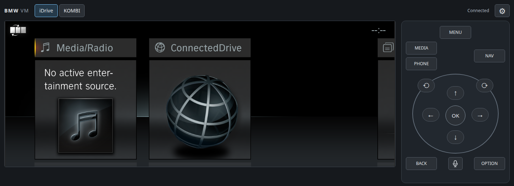
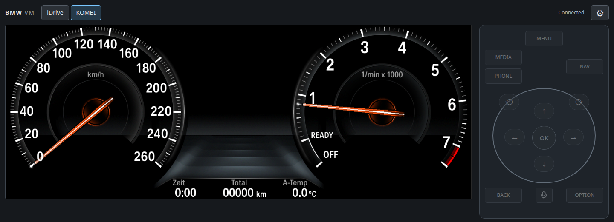

# BMW iDrive 6 emulator

Native BMW F32 iDrive 6 Light in patched QEMU, with a local browser interface,
iDrive controls and a separate native BO03 6WB cluster. The head unit remains
ARM/QNX; Linux x86_64 and Apple silicon macOS are host platforms.



*Real ARM/QNX HmiMain3D rendered through Mesa and noVNC on Linux—not an HTML
imitation. Firmware is supplied externally and is not included.*

<details>
<summary>Native BO03 6WB cluster</summary>



The MIPS/Capricorn-M cluster is a separate guest; its browser tab is view-only.

</details>

**One session:** head unit + optional cluster + browser + next-boot Coding.

[Quick start](#quick-start) · [Prepared inputs](#advanced-operator-prepared-head-unit-inputs) · [Credits and provenance](CREDITS.md)

## Quick start

The Nix flake provides Apple silicon macOS (`aarch64-darwin`, ANGLE Metal)
and Linux x86_64 (`x86_64-linux`, Mesa software EGL) host packages. Linux host
support is experimental: host compilation and firmware-free EGL tests do not
qualify the complete firmware boot/UI path. The guest remains ARM/QNX.

With Nix flakes enabled, clone the repository, copy the example config, and
set `psdzdata` to the absolute path of your extracted PSdZData directory:

```sh
cp idrive6.example.toml idrive6.toml
```

```toml
psdzdata = "/path/to/psdzdata"
modules = ["head-unit", "6wb"]
```

For the first run, check and stage the firmware:

```sh
nix run .#idrive6 -- --prepare-only
```

Start the complete browser session:

```sh
nix run .#idrive6 -- --web
```

Open <http://127.0.0.1:8090/>. For native desktop windows instead, omit `--web`:

```sh
nix run .#idrive6
```

The default module selection opens the head unit, cluster, and HUD as
three windows. Use `modules = ["head-unit"]` or `modules = ["6wb"]` to
start one ECU. Closing a selected ECU's window ends the session.

Point `psdzdata` at the directory containing `swe/swfl`. The head unit
uses `swfl_00002719.bin.007_030_001`, `swfl_0000271a.bin.007_030_001`,
and `swfl_00002720.bin.007_030_001`. The 6WB uses the `.bin` and `.xml`
pairs for `00003e5b`, `00003e5c`, and `00003e5d` at `007_003_005`.
The launcher extracts and verifies the selected firmware, then reuses the
verified cache on later runs. By default the cache lives under
`$XDG_CACHE_HOME/idrive6` or `~/.cache/idrive6`.

The optional settings are `cacheDir`, `display`, and `cpuCount` (`1` or `2`).
The display defaults to `cocoa` on macOS and `gtk` on Linux; `none` selects
headless operation on either host. Native Linux windows need a working X11
or Wayland desktop. The 6WB uses SDL windows for either native GUI selection.
The Mesa server itself uses surfaceless EGL, including with `display = "none"`;
it does not need a desktop or GPU. Nix pins its Mesa vendor and software-driver
paths, so the Linux package does not depend on a system-wide graphics setup.
Keep PSdZData and the cache outside the repository; the launcher rejects paths
inside the checkout so local firmware and cache files never enter the Nix
source or store. Both paths may contain spaces.
The launcher reads `./idrive6.toml` by default; pass `--config /path/to/file`
to either command to use another config.

### Advanced: operator-prepared head-unit inputs

For a legally retained, already prepared matching head-unit root/boot image,
explicitly supply both external paths instead of NBT SWFL staging:

```toml
modules = ["head-unit", "6wb"]
preparedRoot = "/external/prepared-root"
bootImage = "/external/boot1.ifs"
psdzdata = "/external/psdzdata" # used only for BO03 in this mode
cacheDir = "/external/fresh-output-cache"
web = true
```

Use the same `nix run .#idrive6` entry point. With `modules = ["head-unit"]`,
`psdzdata` may be omitted. Both prepared paths must be outside the checkout;
required-file metadata is checked before VM spawn. This is **operator-prepared,
not package-verified** input reuse: it does not establish the original SWFL
provenance and is not a way to accept another firmware revision. The unchanged
archive/shader source pins still reject incompatible data. Inputs remain
read-only; each invocation creates fresh output/archive paths and explicitly
overrides the profile's root/boot paths. `--prepare-only` checks the supplied
paths and stages selected BO03 inputs without starting any VM. Never point this
mode at a root with unreviewed third-party applications or optional overlays.
The output cache and prepared root must be disjoint: neither may contain the
other. The boot image must also be outside the mutable output cache.

Developers with an existing artifact environment can invoke the same owner as
`python3 tools/idrive6-launch.py --config /external/config.toml --web` from the
checkout. `IDRIVE_QEMU`, `IDRIVE_KOMBI_QEMU`, `IDRIVE_ANGLE_SERVER` (or
`IDRIVE_ANGLE_EGL_SERVER_BIN`), `IDRIVE_QNX_CLANG`, and `IDRIVE_LZO_LIBRARY`
select the host artifacts; `IDRIVE_NOVNC` and `IDRIVE_WEBSOCKIFY` select the pinned
external web sources. Keep the usual LLVM/host tools in PATH. `IDRIVE_NIX`
selects the existing Nix executable used only to evaluate TOML, not to build
replacement artifacts. The ordinary Nix entry point supplies these automatically.
The integrated owner requires `os.waitid`/`WNOWAIT` to reserve child identities
until group cleanup completes; manual macOS environments need Python 3.13+.
Missing custody support fails before VM spawn; use the pinned Nix launcher.

## Controls and logs

Use the mouse for CID touch. The controller mapping uses the wheel or Page
Up/Page Down to turn, arrow keys to tilt, Return or Space to select, Escape or
Backspace for Back, M for Menu, and O for Options. C or R sends Media/Radio,
T sends Communication, N sends Navigation, and V sends Map. Click the QEMU
window first to give it keyboard focus.

Each run gets its own directory below the cache's `runs/` folder. It contains
the guest serial stream, QEMU debug log, host EGL server log, and a manifest of
the source and firmware inputs. OTF recording, network packet dumps, ANGLE
shader/draw/resource captures, `pdebug`, and the web inspector remain off by
default. For an already staged cache, set `IDRIVE_CACHE_DIR` to the same path
as `cacheDir` (or its default) before using the developer profile runner. For
example, with the default cache location:

```sh
export IDRIVE_CACHE_DIR="${XDG_CACHE_HOME:-$HOME/.cache}/idrive6"
nix develop -c python3 tools/run-hmi-profile.py \
  profiles/f32-x20511i-id6-light.json \
  --set IDRIVE_OTF_CAPTURE=1 \
  --set IDRIVE_OTF_CAPTURE_OUTPUT=/tmp/idrive6-otf.bin \
  --set IDRIVE_OTF_CAPTURE_SERVER_LOG=/tmp/idrive6-otf.log
```

### Integrated local browser session

```sh
nix run .#idrive6 -- --web
```

This one command verifies/stages your external inputs when needed and owns the
head unit, optional BO03 cluster, vehicle simulator and local browser server as
one session. Open <http://127.0.0.1:8090/>. Use `--web-port PORT` (or `webPort`
in TOML) for another unused loopback port; `web = true` selects browser mode in
the config. Browser mode requires `head-unit`; `modules = ["head-unit"]` works
without cluster firmware and shows KOMBI as unavailable. Browser mode suppresses
native display windows, but the ordinary command without `--web` is unchanged.

The two tabs use real, isolated RFB targets. KOMBI is view-only; all fourteen
iDrive buttons are disabled on that tab. Raw NBT serial remains below the display
and is never combined with host or cluster logs. Nix fetches pinned noVNC 1.6.0
and websockify 0.13.0 sources at build time; nothing is downloaded by the web
server or browser. See the [browser guide](tools/web-client/README.md) for pins,
security boundaries, standalone operation and firmware-free tests.

Settings → Coding offers developer menu, reverse-camera coding and the optional
F32 VariantRegistry overlay for the **next fresh launch**. RVC requires F32
resources. The current-boot column is a frozen, run-bound snapshot of the flags
actually supplied to that launch, not a claim that native menu/camera functions
were verified. Saving or editing pending values never changes that column or the
running guest. OFF omits the optional overlay from the next fresh archive; the
base ID6 Light/F32/English/CID profile remains. Source firmware is not modified.
Pending preferences live in the external cache's private `settings/pending.json`;
private boot snapshots and endpoint/source records live under `sessions/`.

Both ConnectedDrive mocks are visibly unavailable, default OFF, and cannot be
enabled in this release. Their private app/provenance/ABI/native qualification is
not provided. Stop the session with Ctrl-C or SIGTERM in the launching terminal;
closing a browser tab does not stop the VMs. Child failure or closing a native
ECU window ends the whole session. Cleanup is bounded to the process groups
created by this invocation; no existing VM, global service or saved PID is adopted.

## Current limits

The F32 home interface, text, controller input, and CID touch run through
BMW's native HmiMain3D and QNX Screen. QEMU supplies an OMAP5430 board model
and a software display path. The PowerVR SGX540 is not fully emulated; the
host EGL bridge implements the graphics calls used by the tested HMI path.
The macOS path continues to use ANGLE; Linux uses Mesa. This fork pairs version-4
RPC with its matching QNX provider for stencil and blend-state forwarding; host
and guest provider protocol versions must match. On Linux x86_64, the built Nix launcher was exercised with operator-prepared
X20511I inputs: native 1440×540 iDrive Home and 1280×480 BO03 rendered in the
browser, and one native rotary detent visibly moved Home focus. The screenshots
above come from that actual app-free/mock-free session. This does not qualify
fresh NBT SWFL staging, every native screen, other firmware, camera video or
macOS runtime. Windows is deferred.

The graphics core includes paired host/provider stencil and blend-state forwarding
and a bounded, hash-pinned [host ESSL selection](docs/NATIVE_SHADER_MAPS.md).
It is not complete private-lab parity: own PluginApp/SDK and ConnectedDrive mocks
are not included. Full ConnectedDrive app behavior and camera video are not claimed.

## Developer notes

- [QEMU patch workflow](docs/qemu-patches.md) explains how to update the four
  topic patches against the pinned QEMU in Nixpkgs.
- [Graphics contract](NATIVE_GRAPHICS_CONTRACT.md) documents the current
  native HMI display path and observed boundaries.
- [HMI startup trace](HMI_STARTUP_DEPENDENCY.md) records the measured service
  and startup dependencies.
- [Third-party notices](THIRD_PARTY_NOTICES.md) covers the QEMU patches and
  optional Vita3K-based shader diagnostics.
- [Credits and provenance](CREDITS.md) identifies the original project, contributors
  and external dependencies; upstream history and notices are retained.
- `tools/` contains the retained firmware extraction, graphics, and QNX
  diagnostics. Enter `nix develop` for the corresponding build tools.

The exact PSdZData package SHA-256 values are pinned in
`tools/idrive6-launch.py`. A different firmware revision must be reviewed and
added as a distinct, verified profile before use. The checked-in shader data is
limited to the host-side ESSL reconstructions and hashes used by this profile;
the original BMW shader payloads are verified from PSdZData at runtime.

## Developer diagnostics

Run the firmware-free extractor, QNX bootstrap, and QEMU device tests with:

```sh
nix develop -c python3 -m unittest discover -s tests -v
```

The firmware staging diagnostics use the same verified input as the launcher;
`nix run .#idrive6 -- --prepare-only` checks and stages it without starting
QEMU. The device tests use QEMU directly and need no firmware or GUI.

### Linux host EGL checks

To build just the Mesa bridge and exercise its real version-4 RPC path without
QEMU, firmware, a desktop, or a GPU:

```sh
mkdir -p build
nix build .#mesa-egl-rpc-server --out-link build/mesa-host
IDRIVE_TEST_EGL_SERVER="$PWD/build/mesa-host/bin/mesa-egl-rpc-server" \
  python3 -m unittest discover -s tests -p test_egl_rpc_server.py -v
```

These opt-in tests start their own localhost server on a temporary port. They
check EGL initialization, an ES2 pbuffer clear/readback, GL errors, malformed
frames, and protocol-version rejection. They do not test QNX boot or the HMI.
The host package/target matrix is evaluated by `test_flake_hosts.py` when Nix
is available; the EGL tests skip unless `IDRIVE_TEST_EGL_SERVER` is set.

Without Nix, the host-only builder uses a C++17 compiler and `pkg-config` for
EGL 1.5/GLES2 development files; install Mesa's software EGL runtime using
your distribution's package manager. Then run:

```sh
tools/build-mesa-egl-rpc-server.sh build/mesa-egl-rpc-server
LIBGL_ALWAYS_SOFTWARE=1 \
  IDRIVE_TEST_EGL_SERVER="$PWD/build/mesa-egl-rpc-server" \
  python3 -m unittest discover -s tests -p test_egl_rpc_server.py -v
```

`IDRIVE_HOST_CXX` (then `CXX`) selects the compiler executable; `PKG_CONFIG`
selects the dependency-query executable. Standard pkg-config search/sysroot
variables are respected. Shell command strings and escaped-space dependency
flags are not supported. This standalone builder does not supply patched QEMU,
QNX cross-build tools, or a firmware launcher; use the Nix entry point above
for the composed host environment. Existing ANGLE-specific diagnostic builders
remain macOS/ANGLE tools, rather than implicitly switching backends.

## Experimental 6WB cluster and HUD

The Bosch BO03 6WB runs in a separate QEMU guest. Its cluster and HUD
open as SDL windows. The live fixture replays KSS startup and HUD
readiness in temporary guest RAM and uses the firmware's unwarped HUD
output.

The launcher prints a local simulator URL. Open it for manual speed and
RPM controls. External simulators can read `GET /api/v1/vehicle` or send
partial updates to `POST /api/v1/vehicle` at that URL. The API uses km/h
for `speed_kph` and RPM for `engine_rpm`.

### Standalone 6WB probe

Use this path to capture startup graphics or run the simulator separately.
Build the Capricorn-M machine and set `BO03_IMAGES` to the unpacked
`firmware/bo03-007_003_005` directory in the cache created by
`nix run .#idrive6 -- --prepare-only`.

```sh
nix build .#qemu-capricorn-m --out-link /tmp/idrive6-capricorn-qemu
kombi_run="$(mktemp -d /tmp/idrive6-kombi.XXXXXX)"
printf '6WB run directory %s\n' "$kombi_run"
nix develop -c python3 tools/kombi-gss-probe.py \
  "$BO03_IMAGES/swfl_00003e5b-bf400000.bin" \
  --config "$BO03_IMAGES/swfl_00003e5c-bec00000.bin" \
  --graphics-data "$BO03_IMAGES/swfl_00003e5d-bc000000.bin" \
  --qemu /tmp/idrive6-capricorn-qemu/bin/qemu-system-mips64el \
  --log "$kombi_run/gss.log" --kss-replay \
  --vehicle-ram "$kombi_run/vehicle.ram" \
  --display vnc=127.0.0.1:1,display=cluster
```

Connect a VNC client to `127.0.0.1:5901`. Use `display=hud` to view the
native HUD. For a one-shot cluster and HUD startup capture, replace the
live RAM and display options with `--capture "$kombi_run/frames"`.

In another terminal, set `kombi_run` to the printed run directory and start
the host-side Python simulator.

```sh
python3 tools/kombi-sim.py --vehicle-ram "$kombi_run/vehicle.ram"
```

Open `http://127.0.0.1:8765/` for controls and browser-rendered previews.
Add `--demo` for a looping feed. External simulators can read
`GET /api/v1/vehicle` and send partial updates. The API uses km/h for
`speed_kph` and RPM for `engine_rpm`. Both fields drive the stock QEMU
renderers through the shared RAM fixture.

```sh
curl --fail -H 'Content-Type: application/json' \
  --data '{"speed_kph":87,"engine_rpm":2300}' http://127.0.0.1:8765/api/v1/vehicle
```

To test head-unit MOST transport, also start the simulator with
`--sipc-port 8766` and launch the head unit with
`IDRIVE_MOST_SIPC_HOST_PORT=8766 nix run .#idrive6`. The native
`DSYSMOSTServer` runs inside the guest. QEMU forwards its upstream TCP SIPC
connection to the host Python process. `GET /api/v1/most?after=0` returns
link state and decoded telegrams. The vehicle-state feed and SIPC telegrams
are separate interfaces. Native MOST delivery to the Kombi still needs
network-master behavior and Kombi registration.
